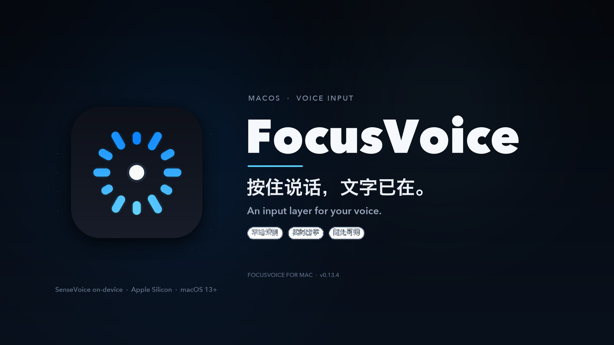
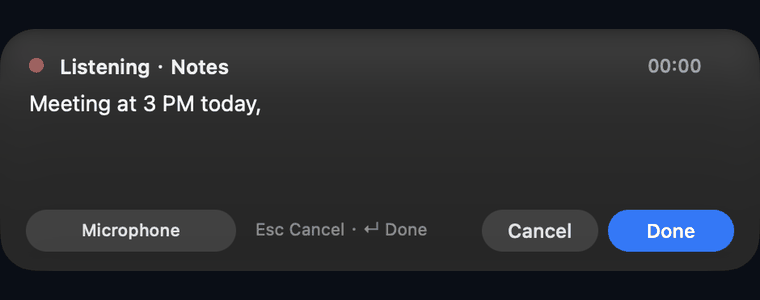
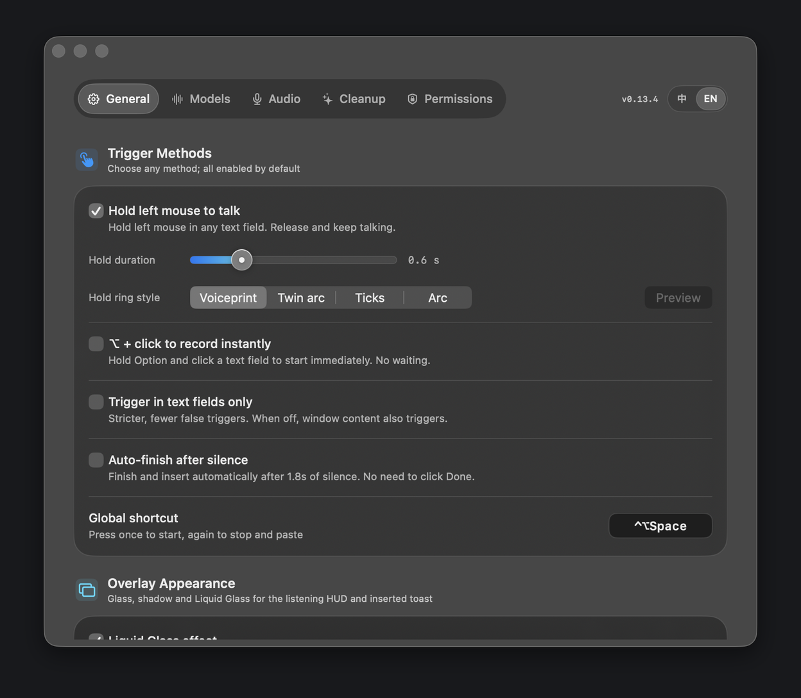
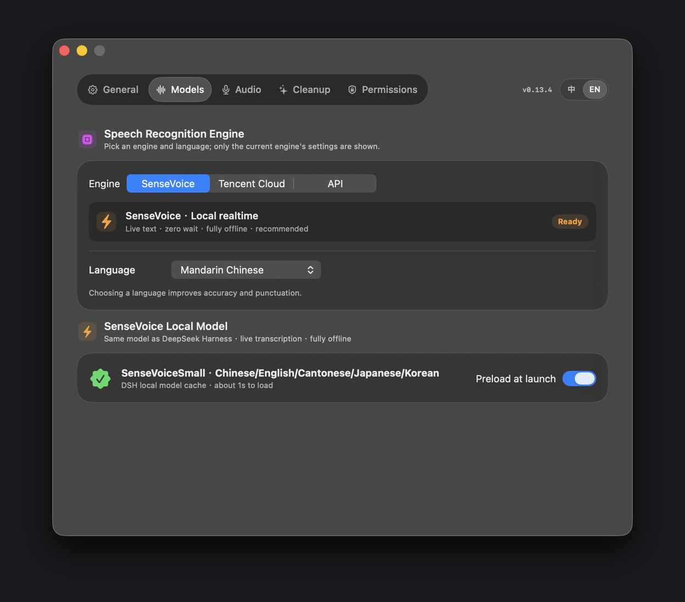
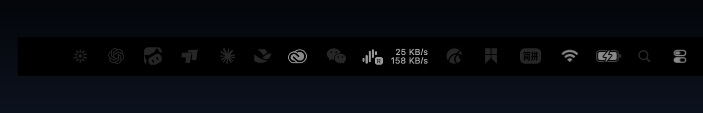

<p align="center">
  
</p>

<h1 align="center">FocusVoice</h1>

<p align="center">
  <b>Hold to talk. Release to think. Your words land in the field you were already typing in.</b><br>
  A native macOS menu-bar voice input app — on-device, streaming, lightweight.
</p>

<p align="center">
  <a href="LICENSE"></a>
  
  
  <a href="README.zh-CN.md">中文说明</a>
</p>

---

## What it is

FocusVoice is a small Swift/AppKit menu-bar utility for macOS. Long-press in any text field,
speak, release — the transcript is inserted into the same field. Recognition runs locally with
**SenseVoiceSmall int8 + Silero VAD** through sherpa-onnx, producing streaming text while you speak.
No account, no cloud round-trip, no 200 MB model in the download.

> **Open source:** the complete source is MIT licensed. The speech model is downloaded on demand
> from Hugging Face and is not part of this repository.

## Feature demos

### Hold-to-talk ring
Hold the left mouse button in a text field. A charge ring fills smoothly from 12 o'clock next to the cursor;
the full highlight appears at the 0.6 s trigger point.

<p align="center"></p>

### Streaming local transcription
Words appear while you are still speaking. The HUD keeps the full transcript and can be scrolled
back with the mouse wheel; it follows the newest text only when you are already at the bottom.

<p align="center"></p>

### Insert and go
Release or press Done. The listening panel is dismissed and the transcript is pasted into the
focused input. A small confirmation bubble appears near the mouse.

<p align="center"></p>

### Designed settings
Native glass panels, voiceprint ring styles, sound library, permissions, model download,
custom hotkey with conflict warnings, and a live Chinese/English switch.

<p align="center">
  
  
</p>

### Lightweight in-app model download
The DMG stays around 13 MB. On first run, FocusVoice downloads the ONNX model, tokens, and VAD
inside the app, with progress and retry. No separate model pack.

<p align="center"></p>

## Highlights

- **On-device streaming ASR** — SenseVoiceSmall int8 + Silero VAD via sherpa-onnx; no audio leaves the Mac.
- **Two recording sources** — built-in microphone or system audio; source switching is protected against overlapping streams.
- **Text-focused workflow** — paste-first insertion with clipboard verification and AX fallback; works with native apps, browsers, Electron clients, and design tools.
- **WYSIWYG insertion** — in raw mode, the text shown in the live HUD is the text inserted.
- **Custom global hotkey** — record any modifier + key combination, with warnings for known system/Codex conflicts.
- **Bilingual UI** — 中文 / English, changed live without restarting.
- **Low-friction visuals** — menu-bar state, charge ring, scrollable live HUD, mouse-anchored toast, configurable glass/shadow.
- **Accessibility-aware** — asks for exactly the permissions needed: Accessibility for insertion, Microphone for voice, Screen Recording only for system audio.
- **Lightweight packaging** — arm64, macOS 13+, ~13 MB DMG; model downloaded only when needed.

## How it works

```
NSStatusItem / NSPanel (AppKit)
        │
        ├── MouseHoldWatcher ── global mouse/keyboard events, charge ring
        ├── UnifiedRecorder ─── built-in mic (AVCaptureSession) / system audio (ScreenCaptureKit)
        ├── SenseVoiceEngine ── sherpa-onnx C API → streaming partial + confirmed text
        ├── RecordingHUD ───── scrollable live transcript
        └── TextInsertion ──── ⌘V paste, read-back check, AX fallback
```

- `Sources/FocusVoice/FocusVoice.swift` — app, HUDs, settings, recording, insertion.
- `Sources/FocusVoice/SenseVoiceEngine.swift` — streaming inference and VAD.
- `Sources/FocusVoice/SenseVoiceModelManager.swift` — on-demand model download.
- `Sources/CSherpa` — C shim for the vendored sherpa-onnx runtime.
- `Vendor/sherpa` — arm64 runtime (Apache-2.0, see `NOTICE.md`).

## Build from source

Requirements: macOS 13+, Xcode Command Line Tools (Swift 6), Apple Silicon.

```bash
git clone https://github.com/Shawwwwwwwwwwww/FocusVoice.git
cd FocusVoice
bash build-macos.sh          # builds and installs /Applications/FocusVoice.app
# or: swift build -c release --disable-sandbox
```

Create a DMG:

```bash
bash scripts/make-dmg.sh
# dist/FocusVoice-0.13.4.dmg
```

The first launch downloads the model from Hugging Face into
`~/Library/Application Support/FocusVoice/Models/sensevoice`.

## Permissions

| Permission | Why |
|---|---|
| Accessibility | Find the focused input and paste / verify text |
| Microphone | Capture the built-in microphone |
| Screen Recording | Optional — only for system-audio recording |

FocusVoice deliberately locks the built-in microphone when connected to AirPods or another
Bluetooth headset; it does not silently switch to the headset mic.

## Keyboard and mouse

- **Hold left mouse** in a text field for 0.6 s to start; release to insert.
- **Custom global hotkey** (default `⌃⌥Space`) toggles recording; configure it in Settings.
- **Option + click** can be enabled as an instant trigger.
- `Esc` cancels; `⌘↩` / Done finishes and inserts.

## Privacy

- Audio and transcripts are processed on-device.
- No analytics, accounts, or remote logging.
- Tencent Cloud streaming ASR is an optional, explicitly configured engine; it is off by default.
- Model downloads only contact the URLs shown in the app.

## License

MIT © 2026 Sun Hui. See [LICENSE](LICENSE) and [NOTICE.md](NOTICE.md).

If you build a product on top of FocusVoice, attribution is appreciated but not required.
