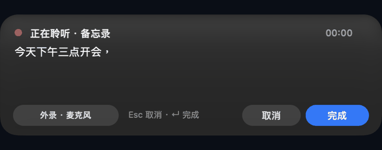
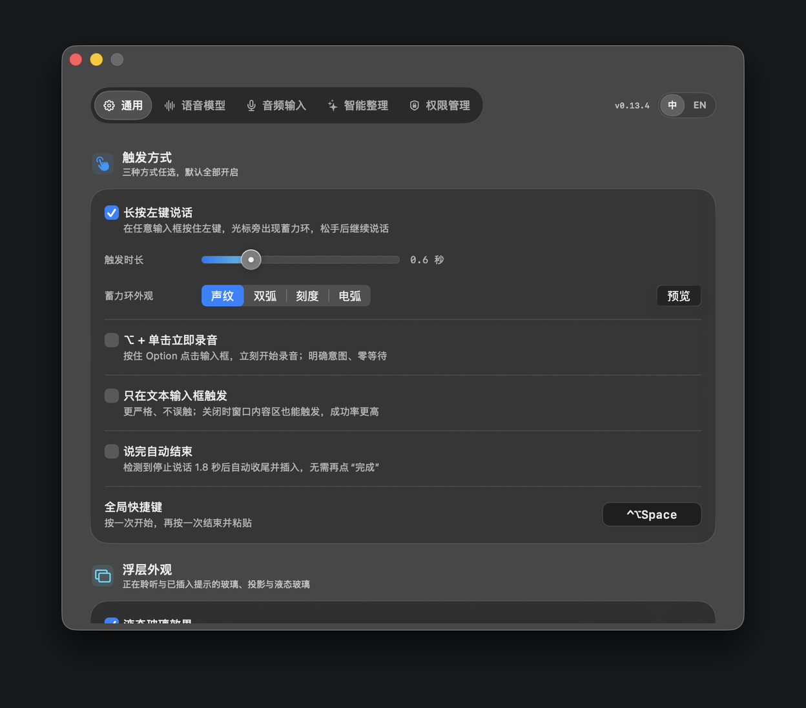
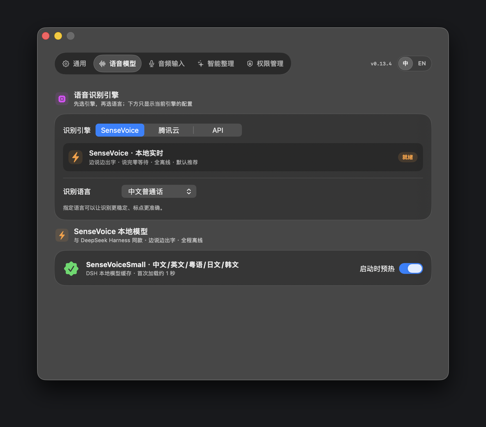

<p align="center">
  
</p>

<h1 align="center">FocusVoice</h1>

<p align="center">
  <b>按住说话，松手出字，不打断你正在输入的地方。</b><br>
  原生 macOS 菜单栏语音输入 · 本地实时识别 · 轻量安装
</p>

<p align="center">
  <a href="LICENSE"></a>
  
  
  <a href="README.md">English</a>
</p>

---

## 这是什么

FocusVoice 是一个 Swift / AppKit 写的 macOS 菜单栏小工具：在任意输入框里**长按左键**，
把想说的话说出来，松手后文字直接插入原来的输入框。

识别在本地完成：**SenseVoiceSmall int8 + Silero VAD**，通过 sherpa-onnx 流式输出，
边说边出字，不需要账号，不把录音上传到云端。

> **完全开源：** 源码使用 MIT 协议。语音模型不放进仓库，首次运行时由 App 内下载。

## 功能演示

### 长按触发 · 声纹蓄力环
在输入框里按住左键，光标旁出现标准进度蓄力环，从 12 点方向顺时针填充；0.6 秒充满时整圈高亮，松手开始收尾。

<p align="center"></p>

### 本地实时转写
一边说一边出字。HUD 保留完整转录，可用滚轮回看；只有当你停在底部时才自动跟随最新文字。

<p align="center"></p>

### 完成即插入
点「完成」或松手后，聆听面板直接收起，文字插入当前输入框，鼠标附近出现轻量确认气泡。

<p align="center"></p>

### 设置与个性化
原生玻璃质感设置页：声纹环外观、音效库、权限、模型下载、自定义快捷键与冲突提醒，
中英文实时切换。

<p align="center">
  
  
</p>

### 轻量安装 · 模型按需下载
DMG 约 13 MB；首次启动在 App 内下载 ONNX 模型、词表和 VAD，带进度和重试，不额外塞一个模型包。

<p align="center"></p>

## 能力

- **本地流式识别**：SenseVoiceSmall int8 + Silero VAD，录音不离开本机；
- **两种来源**：MacBook 内置麦克风或系统声音；切换来源有代际保护，不会内外同时录；
- **文本输入优先**：⌘V 粘贴 + 回读校验 + AX 兜底，兼容原生 App、浏览器、Electron、社交客户端和设计软件；
- **所见即所得**：原文模式下，HUD 里看到的实时文字就是最终插入文字；
- **自定义全局快捷键**：任意修饰键 + 按键组合，内置常见系统/Codex 冲突提醒；
- **中英双语界面**：切换即时生效，无需重启；
- **克制的动效**：菜单栏状态、蓄力环、可滚动实时 HUD、跟随鼠标的完成气泡；
- **权限最小化**：辅助功能用于插入、麦克风用于录音，屏幕录制只在内录时需要；
- **轻量包体**：arm64 / macOS 13+，DMG 约 13 MB，模型按需下载。

## 工作方式

```
NSStatusItem / NSPanel (AppKit)
        │
        ├── MouseHoldWatcher ── 全局鼠标/键盘触发、蓄力环
        ├── UnifiedRecorder ─── 内置麦克风 / ScreenCaptureKit 系统声音
        ├── SenseVoiceEngine ── sherpa-onnx C API → 实时 partial + confirmed
        ├── RecordingHUD ───── 可滚动实时转录
        └── TextInsertion ──── ⌘V 粘贴、回读校验、AX 兜底
```

主要目录：

- `Sources/FocusVoice/FocusVoice.swift` — App、HUD、设置、录音、插入；
- `Sources/FocusVoice/SenseVoiceEngine.swift` — 流式推理与 VAD；
- `Sources/FocusVoice/SenseVoiceModelManager.swift` — 模型下载与安装；
- `Sources/CSherpa` — sherpa-onnx C 桥接；
- `Vendor/sherpa` — arm64 运行时（Apache-2.0，见 `NOTICE.md`）。

## 从源码构建

要求：macOS 13+、Xcode Command Line Tools（Swift 6）、Apple Silicon。

```bash
git clone https://github.com/Shawwwwwwwwwwww/FocusVoice.git
cd FocusVoice
bash build-macos.sh          # 构建并安装到 /Applications/FocusVoice.app
# 或者：swift build -c release --disable-sandbox
```

打包 DMG：

```bash
bash scripts/make-dmg.sh
# dist/FocusVoice-0.13.4.dmg
```

首次启动会从 Hugging Face 下载模型到
`~/Library/Application Support/FocusVoice/Models/sensevoice`。

## 权限

| 权限 | 用途 |
|---|---|
| 辅助功能 | 找到当前输入框并粘贴 / 校验文字 |
| 麦克风 | 采集内置麦克风 |
| 屏幕录制 | 可选，仅内录系统声音时需要 |

连接 AirPods 或其他蓝牙耳机时，FocusVoice 会**明确锁定 MacBook 内置麦克风**，
不会静默切换到耳机麦克风。

## 操作

- 在输入框里**长按左键 0.6 秒**开始，松手插入；
- **自定义全局快捷键**（默认 `⌃⌥Space`）开始/结束录音；
- 可开启 **Option + 单击**立即录音；
- `Esc` 取消，`⌘↩` / 「完成」结束并插入。

## 隐私

- 录音和转录都在本机处理；
- 无账号、无分析上报、无远程日志；
- 腾讯云实时识别是可选且需手动配置的引擎，默认关闭；
- 模型下载只访问 App 内展示的地址。

## 协议

MIT © 2026 Sun Hui。详见 [LICENSE](LICENSE) 与 [NOTICE.md](NOTICE.md)。

基于 FocusVoice 做产品时，欢迎保留署名，但不强制。
