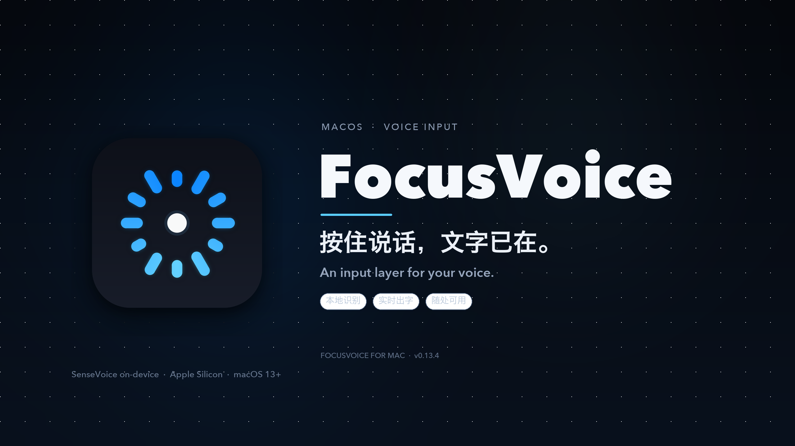
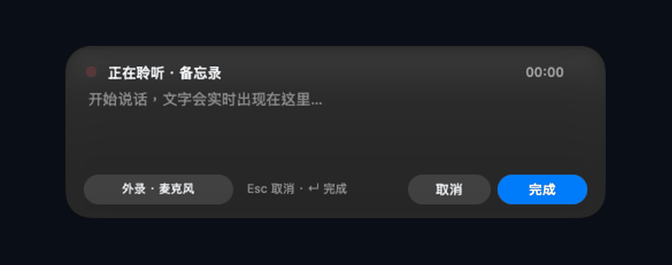
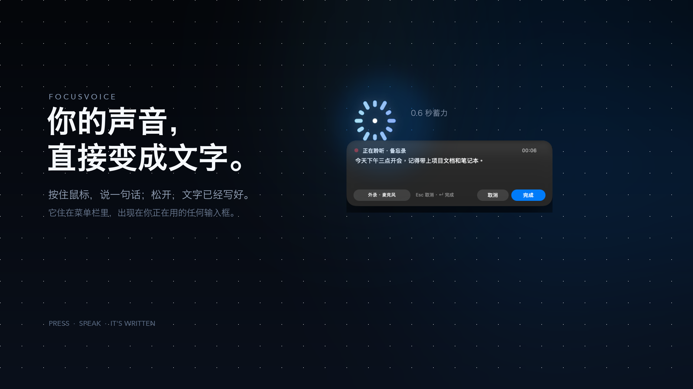
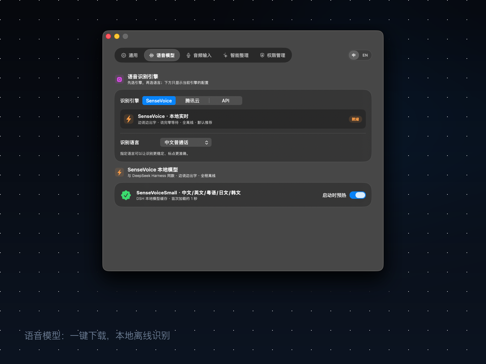
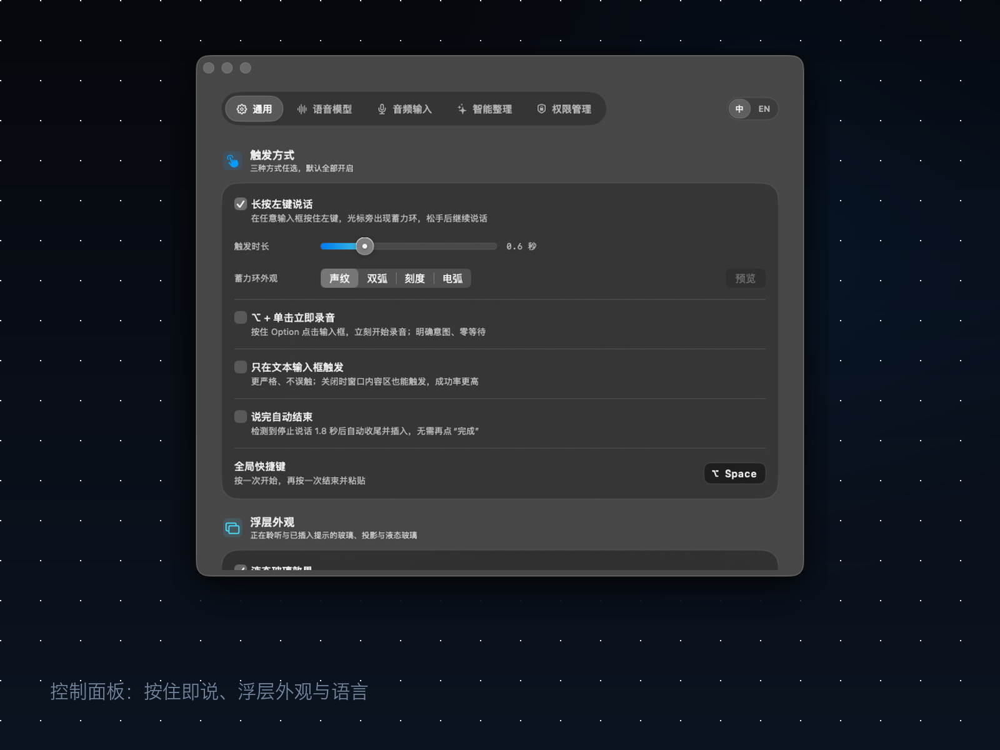

# FocusVoice

**按住说话，文字已在。**

一个住在菜单栏里的语音输入层。按住鼠标，说一句话；松开，文字已经出现在你正在用的地方。

---

## 说，而不是敲。

长按左键 0.6 秒，蓄力环在光标旁出现。松开，继续说。

它不弹窗口，不抢焦点，也不要求你切换应用。

---

## 文字，跟着声音生长。

SenseVoice 在本机实时转写。话说到一半，文字已经在屏幕上；说完，自动落到当前输入框。

---

## 你已经在用的地方。

浏览器、备忘录、聊天窗口、IDE。
FocusVoice 不要求你换应用，只把声音送到当前光标。

---

## 像系统的一部分。

原生 Liquid Glass 浮层、胶囊提示、菜单栏录制状态。
macOS 26 上使用原生 Liquid Glass；更早的系统自动回退到毛玻璃。

---

## 轻，但不妥协。

**13MB** 安装包。模型不塞进安装包里。
首次使用点一次「下载模型」，之后完全离线。

---

## 中文，或 English。

界面跟随你切换，不用重启。
设置、菜单栏、HUD、提示一起切换。

---

## FocusVoice for Mac

- macOS 13 Ventura 或更高
- Apple Silicon（M1 / M2 / M3 / M4）
- 安装包约 13MB，模型约 230MB（首次下载）
- 默认 SenseVoice 本地识别，可选腾讯云 / 自定义 API：声音默认不离开设备

**下载 FocusVoice v0.13.4.dmg**

<small>FocusVoice · Speak, and it's already written.</small>
